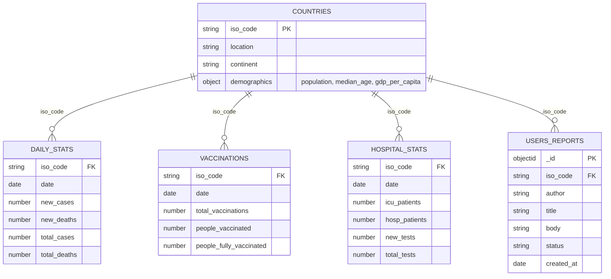
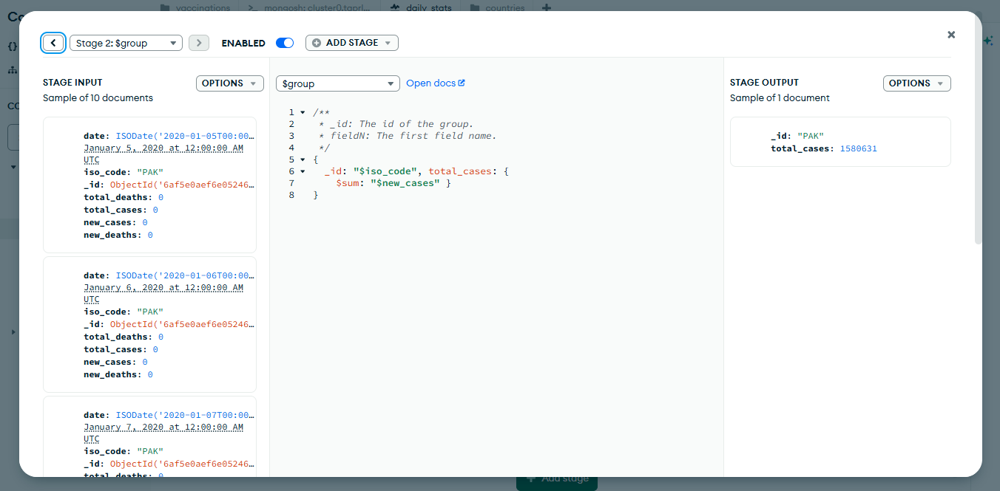
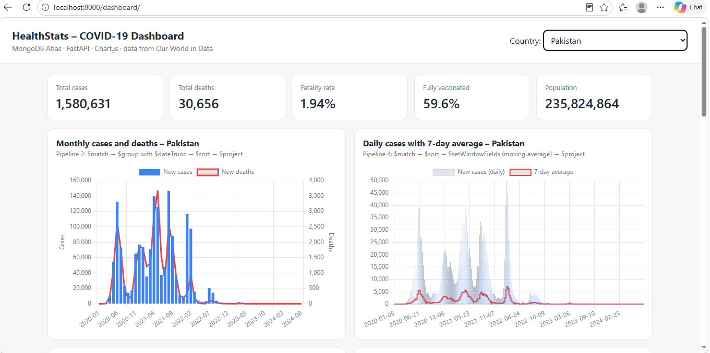
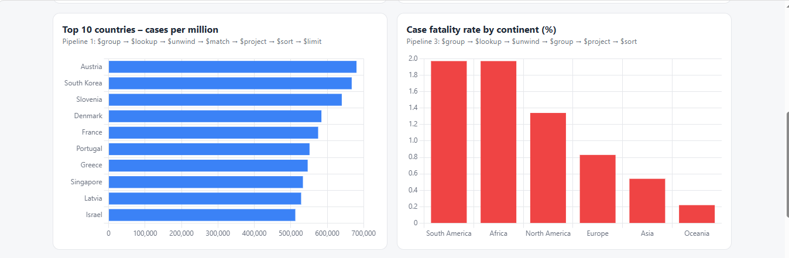
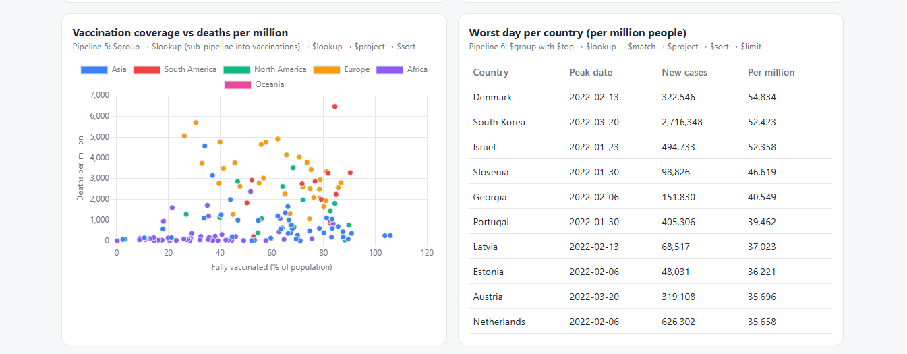
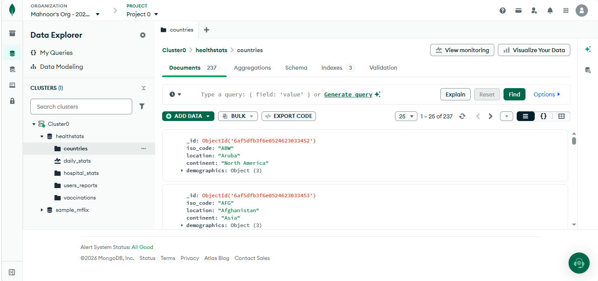
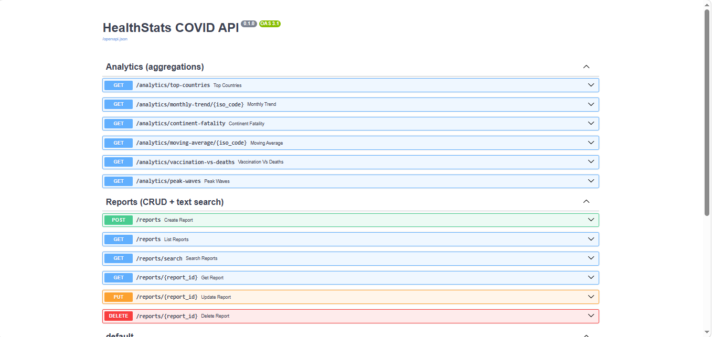
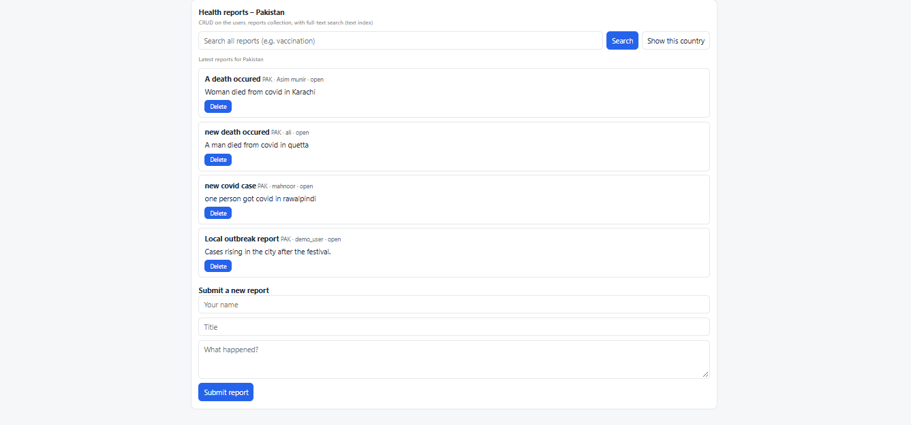
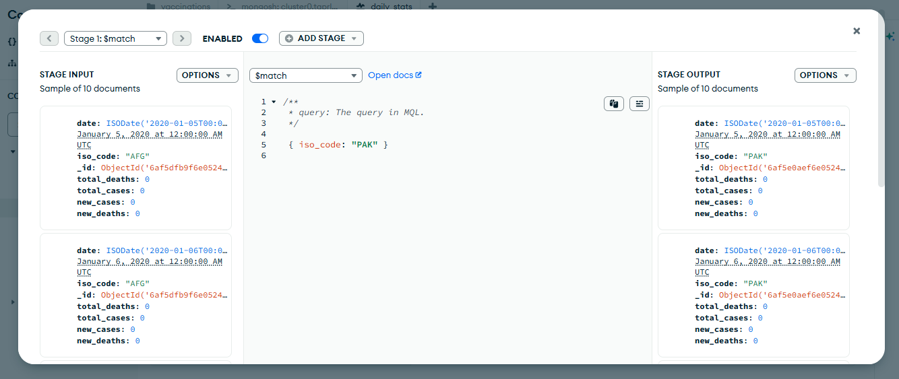

# HealthStats - COVID-19 Dashboard

An Advanced Database Management Systems (ADBMS) project built on **MongoDB Atlas**. It loads the Our World in Data COVID-19 dataset into MongoDB, analyses it with aggregation pipelines, and shows the results on a live dashboard.

**Live demo:** https://healthstats-covid.onrender.com/dashboard/
**API docs (Swagger):** https://healthstats-covid.onrender.com/docs

> The app runs on Render's free tier, so it sleeps after 15 minutes without visitors. The first load can take about 30 seconds.

Author: Mahnoor Rafique

---

## What this project shows

| ADBMS requirement | Where it is in this project |
|---|---|
| MongoDB with 4-5 collections | 5 collections: `countries`, `daily_stats`, `vaccinations`, `hospital_stats`, `users_reports` |
| Schema design (embedding vs referencing) | See [Schema design](#schema-design) |
| CRUD | `backend/app/reports.py` and `mongodb/01_schema_and_crud.js` |
| Indexing with `explain()` before/after | See [Indexing](#indexing-with-explain) |
| At least 5 aggregation pipelines | 6 pipelines in `backend/app/pipelines.py` and `mongodb/03_aggregations.js` |
| One advanced feature | **Time-series collection** (`daily_stats`) and **text search** (`users_reports`) |
| Backend | Python **FastAPI** |
| Frontend | Plain HTML + **Chart.js** dashboard, served by the FastAPI app |
| Deployment | **Render** (free tier) + **MongoDB Atlas** (M0) |

## Tech stack

- **Database:** MongoDB Atlas (M0 free tier), MongoDB Compass for inspection
- **Backend:** Python, FastAPI, PyMongo
- **Frontend:** HTML, JavaScript, Chart.js
- **Hosting:** Render
- **Data:** [Our World in Data COVID-19 dataset](https://github.com/owid/covid-19-data)

## Architecture

```
Browser (dashboard, Chart.js)
        |
        v
FastAPI backend (Render)  --->  MongoDB Atlas (5 collections)
```

MongoDB does the data work (indexes, aggregation pipelines, time-series storage, text search). FastAPI exposes it as a REST API and also serves the dashboard page.

## Schema design



| Collection | Documents | Purpose |
|---|---|---|
| `countries` | 237 | One document per country |
| `daily_stats` | 390,042 | Daily cases and deaths (time-series collection) |
| `vaccinations` | 67,728 | Vaccination progress over time |
| `hospital_stats` | - | ICU and hospital numbers, testing |
| `users_reports` | - | User-submitted health reports (CRUD and text search) |

**Embedding vs referencing**

- **Embedded:** a country's demographics (population, median age, GDP per capita) are stored *inside* its `countries` document. They are small, always read together with the country, and rarely change.
- **Referenced:** daily, vaccination and hospital rows are separate collections that point to a country through `iso_code`. This data grows without limit (hundreds of thousands of rows), so embedding it would eventually hit MongoDB's 16 MB document limit.
- Joins are done with `$lookup`. `POST /reports` also checks that the country exists before saving.

## Indexing with explain()

Query tested on `vaccinations`:

```js
db.vaccinations.find({ iso_code: "PAK", date: { $gte: ISODate("2021-01-01") } }).sort({ date: 1 })
```

| | Before index | After index |
|---|---|---|
| Plan | `SORT -> COLLSCAN` | `FETCH -> IXSCAN` |
| Documents examined | **67,728** | **383** |
| Execution time | 53 ms | 1 ms |

Index created: `{ iso_code: 1, date: 1 }` (compound). The index also removes the separate sort step, because the index is already ordered by date.



Run it yourself: `python backend/scripts/explain_demo.py` or `mongodb/02_indexes_explain.js` in the Mongo shell.

All indexes (`backend/scripts/create_indexes.py`):

- `countries`: unique on `iso_code`, and `continent`
- `vaccinations` and `hospital_stats`: compound `{ iso_code: 1, date: 1 }`
- `users_reports`: `iso_code`, and a **text index** on `title` and `body`
- `daily_stats` (time-series) is indexed automatically on its time and meta fields

## Aggregation pipelines

| # | Endpoint | What it computes | Key stages |
|---|---|---|---|
| 1 | `/analytics/top-countries` | Countries with the most cases per million | `$group`, `$lookup`, `$match`, `$project`, `$sort`, `$limit` |
| 2 | `/analytics/monthly-trend/{iso}` | Cases and deaths per month | `$match`, `$group` with `$dateTrunc`, `$sort` |
| 3 | `/analytics/continent-fatality` | Fatality rate per continent | `$group`, `$lookup`, `$group`, `$cond` |
| 4 | `/analytics/moving-average/{iso}` | 7-day moving average of new cases | `$setWindowFields` |
| 5 | `/analytics/vaccination-vs-deaths` | Vaccination % vs deaths per million | `$lookup` with sub-pipeline |
| 6 | `/analytics/peak-waves` | Worst day per country | `$group` with `$top` |

The pipelines are in [`backend/app/pipelines.py`](backend/app/pipelines.py), and the same pipelines in shell form are in [`mongodb/03_aggregations.js`](mongodb/03_aggregations.js). Each chart on the dashboard is powered by one of them.

## Advanced features

- **Time-series collection:** `daily_stats` is created with `timeField: "date"` and `metaField: "iso_code"`, which stores daily measurements efficiently and supports `$dateTrunc` and `$setWindowFields`.
- **Text search:** a text index on `users_reports` powers `GET /reports/search?q=...`, ranked by relevance (`textScore`).

## API endpoints

| Method | Path | Description |
|---|---|---|
| GET | `/health` | Database connection check |
| GET | `/countries` | List countries |
| GET | `/analytics/...` | The 6 aggregation pipelines |
| POST | `/reports` | Create a report |
| GET | `/reports` | List reports (filters: `iso_code`, `status`) |
| GET | `/reports/search?q=` | Text search |
| GET | `/reports/{id}` | Read one report |
| PUT | `/reports/{id}` | Update a report |
| DELETE | `/reports/{id}` | Delete a report |
| GET | `/dashboard/` | The dashboard |

## MongoDB shell scripts

The `mongodb/` folder has the same database work as plain mongosh commands (run them in Compass's MONGOSH panel):

| File | Contents |
|---|---|
| `01_schema_and_crud.js` | Collections, embedding vs referencing, CRUD |
| `02_indexes_explain.js` | `explain()` before/after and all indexes |
| `03_aggregations.js` | The 6 pipelines |
| `04_advanced_features.js` | Time-series and text search |

## Screenshots

### Dashboard





### MongoDB Atlas



### API and CRUD




### MongoDB Compass


## Run it locally

Requirements: Python 3.12 or newer, Git, and a free MongoDB Atlas account.

```bash
# 1. Get the code
git clone https://github.com/mahnoorxrafique/healthstats-covid.git
cd healthstats-covid/backend

# 2. Create and activate a virtual environment
python -m venv venv
venv\Scripts\activate          # Windows (macOS/Linux: source venv/bin/activate)

# 3. Install packages
pip install -r requirements.txt
```

**4. Configure the database.** Create a free M0 cluster on MongoDB Atlas, add a database user, and allow network access (`0.0.0.0/0` for development). Copy `.env.example` to `.env` and fill in your connection string:

```
MONGODB_URI=mongodb+srv://<user>:<password>@<cluster>.mongodb.net/?retryWrites=true&w=majority
DB_NAME=healthstats
```

`.env` is in `.gitignore`, so credentials are never committed.

**5. Download the data and load it**

```bash
curl -L -o owid-covid-data.csv https://raw.githubusercontent.com/owid/covid-19-data/master/public/data/owid-covid-data.csv
python scripts/load_data.py owid-covid-data.csv
python scripts/create_indexes.py
```

(On Windows PowerShell, use `curl.exe` instead of `curl`.)

**6. Run the app**

```bash
uvicorn app.main:app --reload
```

Open http://localhost:8000 for the dashboard and http://localhost:8000/docs for the API.

## Deployment

- **Database:** MongoDB Atlas M0 (free)
- **App:** Render free web service
  - Root directory: `backend`
  - Build command: `pip install -r requirements.txt`
  - Start command: `uvicorn app.main:app --host 0.0.0.0 --port $PORT`
  - Environment variables: `MONGODB_URI`, `DB_NAME`, `PYTHON_VERSION`

## Project structure

```
healthstats-covid/
├── backend/
│   ├── app/
│   │   ├── main.py          # FastAPI app, serves the dashboard
│   │   ├── db.py            # MongoDB connection
│   │   ├── pipelines.py     # the 6 aggregation pipelines
│   │   ├── analytics.py     # analytics endpoints
│   │   └── reports.py       # CRUD + text search endpoints
│   ├── scripts/
│   │   ├── load_data.py     # loads the CSV into 5 collections
│   │   ├── create_indexes.py
│   │   └── explain_demo.py  # explain() before/after
│   ├── static/index.html    # dashboard (Chart.js)
│   ├── requirements.txt
│   └── .env.example
├── mongodb/                 # mongosh scripts
├── docs/screenshots/
└── README.md
```

## Data source

COVID-19 data from [Our World in Data](https://github.com/owid/covid-19-data) (open data).